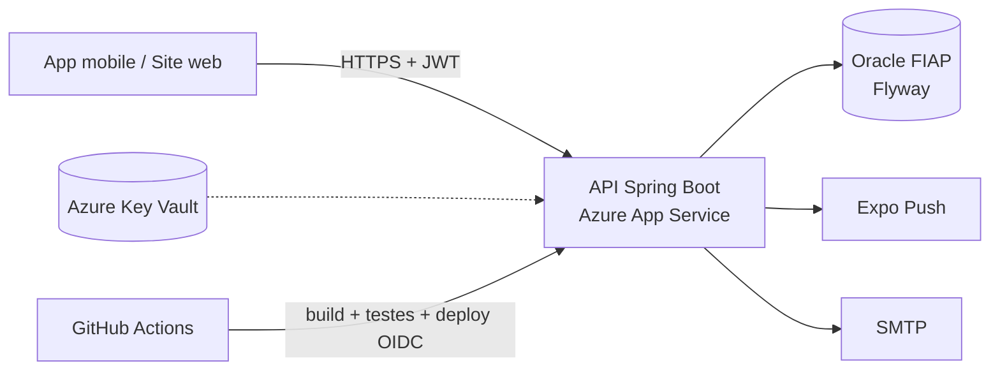

<h1 align="center">🐾 VetSync (JornadaPet)</h1>

<p align="center">
  API REST para continuidade do cuidado e engajamento na jornada de saúde do pet,<br/>
  desenvolvida em parceria com a <strong>Clyvo Vet</strong>.<br/>
  <em>Challenge FIAP 2026 · Java Advanced · Sprint 4 (entrega final)</em>
</p>

<p align="center">
  
  
  
  
  
  
  
  
</p>

---

## 🔗 Links da entrega

| Item | Link |
|------|------|
| 🌐 Aplicação online (Azure App Service) | https://app-vetsync-rm563197.azurewebsites.net |
| 📘 Swagger UI | https://app-vetsync-rm563197.azurewebsites.net/swagger-ui.html |
| ❤️ Health check | https://app-vetsync-rm563197.azurewebsites.net/actuator/health |
| 🎥 Vídeo de apresentação (máx. 15 min) | _PREENCHER: link do vídeo_ |
| 📬 Coleção Postman | [`documentos/JornadaPet_Postman_Collection.json`](documentos/JornadaPet_Postman_Collection.json) |
| 📱 Aplicativo mobile (React Native / Expo) | [Repositorio mobile](https://github.com/Challenge-2TDSPG-2026/vetSync-Mobile.git) |
| 🖥 Site web | https://vetsync-76c0e.web.app/login |

---

## 📑 Sumário

- [Sobre o projeto](#-sobre-o-projeto)
- [Narrativa da solução](#-narrativa-da-solução)
- [Funcionalidades](#-funcionalidades)
- [Perfis de acesso](#-perfis-de-acesso)
- [Tecnologias](#-tecnologias)
- [Arquitetura](#-arquitetura)
- [Decisões de design e justificativas](#-decisões-de-design-e-justificativas)
- [Integração multidisciplinar](#-integração-multidisciplinar)
- [Diagramas e evidências](#-diagramas-e-evidências)
- [Estrutura do projeto](#-estrutura-do-projeto)
- [Pré-requisitos](#-pré-requisitos)
- [Como executar](#-como-executar)
- [Variáveis de ambiente](#-variáveis-de-ambiente)
- [Banco de dados e migrations](#-banco-de-dados-e-migrations)
- [Documentação da API](#-documentação-da-api)
- [Segurança](#-segurança)
- [Testes](#-testes)
- [CI/CD e deploy](#-cicd-e-deploy)
- [Documentação complementar](#-documentação-complementar)
- [Equipe](#-equipe)
- [Licença](#-licença)

---

## 📖 Sobre o projeto

O **VetSync** (também referenciado como *JornadaPet*) é uma API REST que centraliza a jornada de saúde de pets, conectando **tutores**, **clínicas veterinárias**, **veterinários** e **profissionais de estética animal**.

O sistema ajuda o tutor a não perder vacinas, consultas e retornos, dá ao veterinário uma visão operacional da agenda e dos pacientes, e mantém um histórico clínico confiável e auditável. Um programa de **pontos e recompensas** incentiva o cuidado preventivo.

Projeto desenvolvido para o **Challenge FIAP 2026** (disciplina *Java Advanced*, turma 2TDSPG) em parceria com a **Clyvo Vet**. A API é consumida por um aplicativo mobile (React Native / Expo) e por um site web.

## 🎯 Narrativa da solução

**Problema (desafio Clyvo Vet):** a saúde do pet é fragmentada. Vacinas atrasam, retornos são esquecidos, o histórico fica espalhado em papéis e conversas, e a clínica perde o vínculo com o tutor entre uma consulta e outra.

**Proposta:** uma plataforma única que acompanha o pet de forma **contínua**, e não apenas no momento da consulta.

| Para quem | Valor entregue |
|-----------|----------------|
| **Tutor** | Carteira de vacinação sempre atualizada, lembretes por push, próximas ações por pet, compartilhamento seguro com cuidadores e pontos/recompensas por cuidado preventivo |
| **Veterinário** | Agenda do dia, slots disponíveis, prontuário, prescrições, planos de tratamento e histórico auditável |
| **Clínica** | Painel administrativo, relatórios, vínculo com tutores por código, catálogo de recompensas e lista de espera |
| **Pet** | Histórico clínico, de peso e de atividades centralizado e acessível a quem cuida dele |

**Diferenciais:**
- **Compartilhamento granular e revogável** (convite com expiração e permissões por pet, carteira pública por link/QR Code).
- **Engajamento mensurável** com pontos que têm estado e validade, e resgates validados pela clínica.
- **IA com humano no controle**: ações sugeridas passam por *preview* e **confirmação explícita** antes de executar.
- **Auditoria** das alterações importantes, filtrável por tipo.

## ✨ Funcionalidades

### 🐕 Pets e tutores
- Cadastro, edição, busca e paginação de pets, com **foto** e catálogo de **espécies e raças**
- Gestão de tutores e **responsáveis adicionais**
- **Perfil de saúde** do pet (alergias, medicamentos contínuos, condições pré-existentes, etc.)
- **Histórico de peso** para gráficos de evolução e **histórico de atividades** do pet
- **Acesso compartilhado**: convites por link/token com expiração, permissões granulares e revogação imediata

### 🩺 Eventos clínicos e agenda
- Eventos de saúde (consultas, vacinas, vermifugação, estética etc.) com status, custo, observações clínicas, diagnóstico e conduta
- **Detalhes completos**, **histórico de alterações**, **anexos** e **reagendamento** de eventos
- Conclusão e cancelamento de eventos
- **Agenda do dia** e **slots disponíveis** por veterinário, com disponibilidades e bloqueios
- **Lista de espera** e confirmação de agendamentos
- Cálculo de **gasto total** e **alertas** por pet
- **Agendamento de retorno** por link público com token

### 💉 Vacinação e prevenção
- **Carteira de vacinação** com tipos de vacina, periodicidade e status calculado (em dia, vencendo, atrasada)
- **Carteira compartilhável** por link público/QR Code, com expiração configurável
- **Próximas ações e pendências** por pet

### 💊 Tratamentos e prontuário
- **Prescrições** (com anexo em PDF) e catálogo de **medicamentos**
- **Planos de tratamento** com itens agendáveis
- **Prontuário clínico** com compartilhamento temporário para outro atendimento

### ✂️ Estética
- Cadastro de **profissionais de estética**, serviços base e extras
- Disponibilidade e bloqueios de agenda dedicados
- **Relatórios de estética** com liberação para o tutor

### 🏥 Clínicas
- **Vínculo tutor–clínica** por código, com troca de clínica e ativação de contrato
- **Equipe da clínica**, perfil e catálogo de serviços
- **Painel administrativo** com resumo e **relatórios da clínica**
- **Auditoria** das alterações importantes, filtrável por tipo

### 🎁 Pontos e recompensas
- Lançamento de **pontos** por eventos realizados, com estados (pendente, liberado, bloqueado) e **validade**
- **Catálogo de recompensas** com imagem, **resgate** pelo tutor e **validação** pela clínica

### 🔔 Notificações
- Registro de dispositivos (**Expo Push**), notificações in-app e **preferências** por usuário
- Job agendado de **lembretes** com respeito ao fuso horário

### 🤖 IA (SIA)
- **Ações assistidas por IA** com fluxo de *preview* e **confirmação explícita** antes da execução (`/ia/acoes`)

### 🔑 Login social
- Login e vínculo de conta com **Google** e **Apple** (validação do `id_token` por audiência configurável)

## 👥 Perfis de acesso

| Perfil | Descrição |
|--------|-----------|
| `TUTOR` | Dono do pet: gerencia pets, eventos, vacinas, pontos e resgates |
| `VETERINARIO` | Atende pacientes, gerencia agenda, prescrições e planos de tratamento |
| `PROFISSIONAL_ESTETICA` | Gerencia serviços, agenda e relatórios de estética |
| `ADMIN` | Administra clínicas, vínculos, recompensas, pontos e painel |
| `ADMIN_CLINICA` | Administra a operação de uma clínica específica |

A autorização é feita por *roles* (`@PreAuthorize` com `hasRole`/`hasAnyRole`) e por regras de propriedade (por tutor, pet, veterinário e clínica) nas classes do pacote `security`.

## 🛠 Tecnologias

| Categoria | Tecnologia |
|-----------|------------|
| Linguagem | Java 17 |
| Framework | Spring Boot 3.3.5 (Web, Data JPA, Validation, Security, Actuator, Cache, Mail, Thymeleaf) |
| Autenticação | JWT (jjwt 0.11.5) + BCrypt + login social (Google/Apple) |
| Banco de dados | Oracle (FIAP) em produção · H2 (modo Oracle) nos testes |
| Migrations | Flyway (`flyway-core` + `flyway-database-oracle`) |
| Documentação | SpringDoc OpenAPI 2.6.0 (Swagger UI) |
| Produtividade | Lombok |
| Testes | JUnit 5, Spring Boot Test, Spring Security Test, MockMvc, JaCoCo |
| Containers | Docker, Docker Compose |
| Cloud / CI-CD | Azure App Service, Azure Key Vault, GitHub Actions (OIDC) |

## 🏗 Arquitetura

Arquitetura em camadas, com separação clara de responsabilidades:

```
Cliente (App Mobile / Web)
        │  HTTPS + JWT
        ▼
┌──────────────────────────────────────────────────────────┐
│  Controller   (REST + OpenAPI + validação @Valid)         │
├──────────────────────────────────────────────────────────┤
│  Security     (JWT, @PreAuthorize, regras por propriedade)│
├──────────────────────────────────────────────────────────┤
│  Service      (regras de negócio, jobs @Scheduled)        │
├──────────────────────────────────────────────────────────┤
│  Repository   (Spring Data JPA)                           │
└──────────────────────────┬───────────────────────────────┘
                           ▼
                    Oracle (Flyway)
```

Pontos de atenção do projeto:
- **Sessões stateless** com JWT; logout com *blacklist* de tokens e invalidação de sessões após troca de senha
- **Rate limiter** no endpoint público da carteira compartilhada
- Tratamento global de exceções (`GlobalExceptionHandler`)
- Cache em memória (`spring.cache.type=simple`)
- Job agendado (`@Scheduled`) para lembretes e notificações

## 🧭 Decisões de design e justificativas

| Decisão | Justificativa |
|---------|---------------|
| **JWT stateless** com blacklist no logout | Escala horizontalmente no App Service e atende app mobile e web; a blacklist e a invalidação após troca de senha cobrem a principal fraqueza do JWT (token roubado) |
| **Flyway como única fonte do esquema** (`ddl-auto=none`) | Esquema versionado e reproduzível em qualquer ambiente; evita divergência entre entidades e banco |
| **Autorização por propriedade além de roles** | Role sozinha não impede um tutor de ler o pet de outro; as classes `*Security` validam o vínculo com o recurso |
| **Pool Hikari com 2 conexões** | Respeita a cota `SESSIONS_PER_USER` do Oracle FIAP |
| **IA com *preview* + confirmação** | Dados de saúde são sensíveis; nenhuma ação sugerida executa sem o aceite do usuário |
| **Links públicos com token, expiração e rate limit** | Permite compartilhar carteira/prontuário sem criar conta, com superfície de ataque controlada |
| **Auditoria como serviço próprio** | Rastreabilidade das alterações clínicas para a clínica e para o tutor |
| **CI com checksum SHA-256 + deploy via OIDC** | O artefato implantado é exatamente o que foi testado, sem segredos de longa duração no GitHub |
| **Segredos no Azure Key Vault** | Nenhuma credencial no repositório |

## 🔗 Integração multidisciplinar

Como as demais disciplinas do semestre foram aplicadas nesta solução:

| Disciplina | Aplicação no projeto | Evidência |
|------------|----------------------|-----------|
| **Java Advanced** | API Spring Boot completa: Security/JWT, Flyway, validações, testes | Este repositório |
| **Mastering Relational and Non-Relational Database** | Modelagem relacional em Oracle com 61 tabelas, versionada por migrations Flyway | [`scripts/Database/script_bd.sql`](scripts/Database/script_bd.sql) · [`src/main/resources/db/migration`](src/main/resources/db/migration) |
| **DevOps Tools & Cloud Computing** | Pipeline GitHub Actions com build, testes e deploy no Azure App Service via OIDC; infraestrutura criada por Azure CLI; segredos no Key Vault | [`.github/workflows/deploy-azure.yml`](.github/workflows/deploy-azure.yml) · [`azure-pipelines.yml`](azure-pipelines.yml) · [`scripts/`](scripts) · [`Dockerfile`](Dockerfile) |
| **Mobile Application Development** | O app React Native/Expo consome esta API (JWT, push via Expo, carteira, agenda) | [Repositorio mobile](https://github.com/Challenge-2TDSPG-2026/vetSync-Mobile.git) |
| **Disruptive Architectures: IoT, IoB & Generative IA** | Módulo de ações assistidas por IA com preview e confirmação | [`AcaoIaController`](src/main/java/br/com/fiap/VetSync/controller/AcaoIaController.java) · migration `V30__cria_acoes_ia.sql` |
| **Compliance, Quality Assurance & Tests** | Testes automatizados (unitários, de controller, de segurança e de integração) executados no CI; coleção Postman | [`src/test`](src/test) · [`documentos/JornadaPet_Postman_Collection.json`](documentos/JornadaPet_Postman_Collection.json) · _PREENCHER: link do Azure Boards_ |

## 🗺 Diagramas e evidências

Visão geral da arquitetura (diagramas completos de CI/CD e domínios em [`documentos/arquitetura.md`](documentos/arquitetura.md)):



| Evidência | Onde |
|-----------|------|
| Diagramas de arquitetura, CI/CD e domínios | [`documentos/arquitetura.md`](documentos/arquitetura.md) |
| Modelo físico (DDL) | [`scripts/Database/script_bd.sql`](scripts/Database/script_bd.sql) |
| Evolução do esquema | [`src/main/resources/db/migration`](src/main/resources/db/migration) |
| Coleção Postman | [`documentos/JornadaPet_Postman_Collection.json`](documentos/JornadaPet_Postman_Collection.json) |
| Mapa de endpoints | [`documentos/endpoints.txt`](documentos/endpoints.txt) |
| Roteiro do vídeo de apresentação | [`documentos/roteiro-video.md`](documentos/roteiro-video.md) |
| Checklist de rubrica e penalidades | [`documentos/checklist-sprint4.md`](documentos/checklist-sprint4.md) |
| Contas fictícias de demonstração | [`scripts/usuarios_demo.md`](scripts/usuarios_demo.md) |
## 📂 Estrutura do projeto

```
vetSync-Java/
├── .github/workflows/        # Pipeline CI/CD (deploy-azure.yml)
├── azure-pipelines.yml       # Pipeline equivalente para Azure DevOps
├── .mvn/                     # Maven Wrapper
├── documentos/               # Postman, roadmap, diagramas, roteiro do vídeo e checklist
├── scripts/                  # Provisionamento Azure e DDL Oracle
│   └── Database/script_bd.sql
├── src/
│   ├── main/
│   │   ├── java/br/com/fiap/VetSync/
│   │   │   ├── config/       # SecurityConfig, SwaggerConfig
│   │   │   ├── controller/   # Endpoints REST
│   │   │   ├── entity/       # Entidades JPA e enums de status
│   │   │   ├── exception/    # GlobalExceptionHandler
│   │   │   ├── repository/   # Repositórios Spring Data
│   │   │   ├── security/     # JWT, filtros e regras de acesso
│   │   │   ├── service/      # Regras de negócio
│   │   │   └── social/       # Verificação de tokens Google/Apple
│   │   └── resources/
│   │       ├── db/migration/ # Migrations Flyway (V1 a V56)
│   │       ├── static/       # Console de testes (index.html)
│   │       ├── templates/    # Páginas públicas (Thymeleaf)
│   │       └── application.properties
│   └── test/                 # Testes unitários, de controller, segurança e integração
├── Dockerfile
├── docker-compose.yml
└── pom.xml
```

## ✅ Pré-requisitos

- **JDK 17+**
- **Git**
- **Maven 3.9+** (opcional, o projeto inclui o `mvnw`)
- **Docker** e **Docker Compose** (opcional, para execução em containers)
- Acesso a um banco **Oracle** (ou o container Oracle XE do `docker-compose.yml`)

## 🚀 Como executar

### 1. Clonar o repositório

```bash
git clone https://github.com/Challenge-2TDSPG-2026/vetSync-Java.git
cd vetSync-Java
```

### 2. Configurar as variáveis de ambiente

As variáveis `JWT_SECRET` e `ADMIN_BOOTSTRAP_KEY` são **obrigatórias**. Veja a [lista completa](#-variáveis-de-ambiente).

```bash
export JWT_SECRET="uma-chave-secreta-com-no-minimo-32-caracteres"
export ADMIN_BOOTSTRAP_KEY="chave-para-criar-o-primeiro-admin"
export SPRING_DATASOURCE_URL="jdbc:oracle:thin:@oracle.fiap.com.br:1521:ORCL"
export SPRING_DATASOURCE_USERNAME="RMXXXXXX"
export DB_PASSWORD="sua-senha"
```

> No Windows PowerShell, use `$env:JWT_SECRET = "..."`.

### 3a. Executar localmente com Maven

```bash
./mvnw spring-boot:run
```

### 3b. Executar com Docker Compose (Oracle XE + API)

Crie um arquivo `.env` na raiz (ele já está no `.gitignore`):

```env
JWT_SECRET=uma-chave-secreta-com-no-minimo-32-caracteres
ADMIN_BOOTSTRAP_KEY=chave-para-criar-o-primeiro-admin
```

Suba os serviços:

```bash
docker compose up --build
```

O compose sobe um **Oracle XE 21** e a aplicação na porta **8080**. A aplicação roda no container com **usuário não-root**.

> Os valores de usuário e senha do banco no `docker-compose.yml` são apenas para **desenvolvimento local**. Nunca os reutilize em produção.

### 3c. Gerar o JAR

```bash
./mvnw clean package
java -jar target/VetSync-0.0.1-SNAPSHOT.jar
```

### 4. Acessar

| Recurso | URL local | URL online |
|---------|-----------|------------|
| API | `http://localhost:8080` | https://app-vetsync-rm563197.azurewebsites.net |
| Swagger UI | `http://localhost:8080/swagger-ui.html` | https://app-vetsync-rm563197.azurewebsites.net/swagger-ui.html |
| OpenAPI (JSON) | `http://localhost:8080/v3/api-docs` | https://app-vetsync-rm563197.azurewebsites.net/v3/api-docs |
| Health check | `http://localhost:8080/actuator/health` | https://app-vetsync-rm563197.azurewebsites.net/actuator/health |
| Console de testes | `http://localhost:8080/` | https://app-vetsync-rm563197.azurewebsites.net/ |

### 5. Criar o primeiro administrador

Com a aplicação no ar, use o endpoint de bootstrap, protegido pela `ADMIN_BOOTSTRAP_KEY`:

```
POST /admins/bootstrap
```

Consulte o Swagger para o formato do corpo e do cabeçalho esperados.

## ⚙️ Variáveis de ambiente

| Variável | Obrigatória | Padrão | Descrição |
|----------|:-----------:|--------|-----------|
| `JWT_SECRET` | ✅ | — | Segredo de assinatura dos tokens JWT |
| `ADMIN_BOOTSTRAP_KEY` | ✅ | — | Chave para criar o primeiro administrador |
| `SPRING_DATASOURCE_URL` | | `jdbc:oracle:thin:@oracle.fiap.com.br:1521:ORCL` | URL JDBC do banco |
| `SPRING_DATASOURCE_USERNAME` | | — | Usuário do banco |
| `DB_PASSWORD` | | — | Senha do banco |
| `SPRING_FLYWAY_ENABLED` | | `true` | Habilita as migrations |
| `SERVER_PORT` | | `8080` | Porta da aplicação |
| `MAIL_HOST` / `MAIL_PORT` | | `localhost` / `587` | Servidor SMTP |
| `MAIL_USERNAME` / `MAIL_PASSWORD` | | — | Credenciais SMTP (recuperação de senha) |
| `APP_CORS_WEB_ORIGIN` | | — | Origens web extras liberadas no CORS (separadas por vírgula) |
| `WEB_INVITE_URL` | | `https://vetsync.site/convite` | Página web que trata o aceite de convites |
| `PET_CONVITE_EXPIRACAO_HORAS` | | `72` | Validade do convite de acesso ao pet |
| `CARTEIRA_COMPARTILHADA_EXPIRACAO_DIAS` | | `30` | Validade do link da carteira compartilhada |
| `PRONTUARIO_COMPARTILHAMENTO_EXPIRACAO_DIAS` | | `7` | Validade do link de prontuário compartilhado |
| `AGENDA_EXIGE_CONFIRMACAO` | | `false` | Se `true`, todo agendamento novo fica pendente até a clínica confirmar |
| `NOTIFICACOES_PUSH_HABILITADO` | | `true` | Liga/desliga o envio de push |
| `NOTIFICACOES_JOB_HABILITADO` | | `true` | Liga/desliga o job de lembretes |
| `NOTIFICACOES_FUSO_CLINICA` | | `America/Sao_Paulo` | Fuso padrão da clínica |
| `EXPO_PUSH_URL` | | `https://exp.host/--/api/v2/push/send` | Endpoint do Expo Push |
| `GOOGLE_CLIENT_ID` / `GOOGLE_ANDROID_CLIENT_ID` / `GOOGLE_IOS_CLIENT_ID` | | — | Audiências aceitas no login Google (vazio = desabilitado) |
| `APPLE_CLIENT_ID` / `APPLE_SERVICE_ID` | | — | Audiências aceitas no login Apple (vazio = desabilitado) |
| `MANAGEMENT_ENDPOINT_HEALTH_SHOW_DETAILS` | | `never` | Detalhes do `/actuator/health` |

Parâmetros fixos relevantes: validade dos pontos de **365 dias**, upload máximo de **5 MB** e expiração do JWT de **24 h**.

## 🗄 Banco de dados e migrations

- O esquema é gerenciado **exclusivamente pelo Flyway** (`spring.jpa.hibernate.ddl-auto=none`).
- As migrations ficam em `src/main/resources/db/migration` (de `V1__create_tables.sql` até `V56__adiciona_data_cadastro_pet.sql`).
- O pool Hikari é limitado a **2 conexões** para respeitar a cota `SESSIONS_PER_USER` do Oracle FIAP.
- O DDL consolidado (61 tabelas) está em `scripts/Database/script_bd.sql`.
- Nos testes é usado **H2 em modo Oracle**, sem dependência de banco externo.

## 📡 Documentação da API

A documentação interativa está no **Swagger UI** (`/swagger-ui.html`), com esquema de segurança `bearerAuth` (JWT). Uma coleção Postman está em [`documentos/JornadaPet_Postman_Collection.json`](documentos/JornadaPet_Postman_Collection.json).

Resumo dos principais grupos de rotas (consulte o Swagger para o detalhamento):

| Grupo | Base | Destaques |
|-------|------|-----------|
| Autenticação | `/auth` | `login`, `registrar`, `logout`, `me`, `esqueci-senha`, `validar-codigo`, `redefinir-senha`, convites, login social |
| Admin e painel | `/admins`, `/painel` | `bootstrap`, criação de admin, `resumo` |
| Tutores | `/tutores` | consulta, edição e remoção |
| Pets | `/pets` | CRUD, busca, raças, foto, por tutor, atividades |
| Saúde do pet | `/pets/{id}/...` | `proximas-acoes`, `carteira-vacinacao`, `perfil-saude`, `peso`, `peso/historico` |
| Acesso compartilhado | `/pets/{idPet}/acessos`, `/convites` | convites, aceite, permissões, revogação |
| Carteira compartilhável | `/pets/{idPet}/carteira-compartilhavel`, `/carteiras-publicas/{token}` | link público com expiração |
| Eventos | `/eventos` | CRUD, `detalhes`, `historico`, `reagendar`, `concluir`, `cancelar`, `anexos`, estética |
| Tipos de evento | `/tipos-evento` | catálogo de tipos |
| Agenda | `/agenda` | `slots`, `dia` |
| Veterinários | `/veterinarios` | CRUD, disponibilidade, bloqueios |
| Estética | `/profissionais-estetica`, `/servicos-estetica`, `/relatorios-estetica` | profissionais, serviços, relatórios |
| Prescrições | `/prescricoes`, `/medicamentos` | emissão, liberação, catálogo |
| Planos de tratamento | `/planos` | criação, listagem, agendamento de itens |
| Clínicas | `/vinculos-clinica` | validar código, trocar, gerar/remover código, contrato |
| Pontos e recompensas | `/pontos`, `/recompensas` | saldos, liberar/bloquear, resgatar, validar resgate |
| Notificações | `/notificacoes`, `/usuarios/preferencias/notificacoes` | dispositivos, lidas, preferências |
| Relatórios e auditoria | `/veterinarios/me/relatorios`, `/auditoria` | resumo, trilha de auditoria |
| IA | `/ia/acoes` | `preview`, `confirmar` |
| Retorno | `/agendamentos-retorno/{token}` | consulta e confirmação públicas |

### Exemplo de autenticação

```bash
# Login
curl -X POST http://localhost:8080/auth/login \
  -H "Content-Type: application/json" \
  -d '{"email":"tutor@exemplo.com","senha":"suaSenha"}'

# Chamada autenticada
curl http://localhost:8080/auth/me \
  -H "Authorization: Bearer <TOKEN>"
```

A resposta do login traz `token`, `idUsuario`, `email`, `nome`, `perfil` e `temVinculoAtivo`.

## 🔐 Segurança

- Autenticação **JWT stateless** e senhas com **BCrypt**
- `@EnableMethodSecurity` com `@PreAuthorize` e regras de propriedade por tutor, pet, evento, plano e profissional
- **Logout** com blacklist de tokens e invalidação de sessões após troca de senha
- Recuperação de senha por **código enviado por e-mail**
- **CORS** restrito a localhost, emulador Android, site oficial e origens configuradas por ambiente
- Rotas públicas limitadas ao necessário: login, registro, recuperação de senha, convites, carteira pública, retorno por token, health e Swagger; todo o restante exige autenticação
- Segredos fora do código: variáveis de ambiente e **Azure Key Vault**; arquivos `.env` ignorados pelo Git
- Container executado com **usuário não-root**

## 🧪 Testes

O projeto possui testes de **repositório**, **serviço**, **controller (MockMvc)**, **segurança (CORS e controle de acesso)** e **integração** (fluxo de autenticação, bootstrap de admin, planos de tratamento, prontuário e pontos/recompensas), somando mais de **370 métodos de teste em 58 classes**.

```bash
# Executar todos os testes
./mvnw test

# Build completo com verificação (usado no CI)
./mvnw clean verify
```

O relatório de cobertura do **JaCoCo** é gerado em `target/site/jacoco/index.html`.

## ⚡ CI/CD e deploy

O fluxo atual do GitHub Actions está em [`.github/workflows/deploy-azure.yml`](.github/workflows/deploy-azure.yml). A configuração equivalente para Azure DevOps está preparada em [`azure-pipelines.yml`](azure-pipelines.yml). Até a criação e validação do pipeline e da conexão de serviço no Azure DevOps, mantenha o workflow atual ativo.

Ambos executam build e testes com Java 17 em *push* e *pull request* para `main`, gerando o JAR com checksum SHA-256. Em pushes para `main` (e execuções manuais de `main`), fazem deploy do JAR no Azure App Service e validam `/actuator/health`. O Azure DevOps requer a conexão de serviço `sc-vetsync-production`, configurada como Azure Resource Manager com workload identity federation e permissão de deploy no App Service.

Scripts de infraestrutura (Azure CLI) na pasta [`scripts/`](scripts):

| Script | Função |
|--------|--------|
| `1-system.sh` | Cria grupo de recursos, plano e App Service |
| `2-oracle-fiap.sh` | Configura a conexão Oracle FIAP e segredos no Key Vault |
| `3-backend-deploy.sh` | Faz o deploy do backend |
| `4-github-oidc.sh` | Configura identidade federada GitHub → Azure para o workflow atual |
| `sync-oracle-ddl.sh` | Sincroniza o DDL no Oracle |
| `x-delete.sh` | Remove os recursos criados |

## 📚 Documentação complementar

- [`documentos/roadmap-backend.md`](documentos/roadmap-backend.md): roadmap de evolução do backend (notificações, próximas ações, vacinação, auditoria, relatórios e SIA)
- [`documentos/cronograma-sprint1.md`](documentos/cronograma-sprint1.md): cronograma e divisão de responsabilidades da Sprint 1
- [`documentos/JornadaPet_Postman_Collection.json`](documentos/JornadaPet_Postman_Collection.json): coleção Postman
- [`documentos/arquitetura.md`](documentos/arquitetura.md): diagramas de arquitetura, CI/CD e domínios
- [`documentos/roteiro-video.md`](documentos/roteiro-video.md): roteiro do vídeo de apresentação
- [`documentos/checklist-sprint4.md`](documentos/checklist-sprint4.md): checklist de rubrica e penalidades
- [`scripts/usuarios_demo.md`](scripts/usuarios_demo.md): contas fictícias de demonstração

## 👨‍💻 Equipe

| Nome | RM |
|------|----|
| Arthur Brito da Silva | 562085 |
| Luiz Felipe Flosi dos Santos | 563197 |
| Pedro Henrique Brum Lopes | 561780 |

**Instituição:** FIAP · **Disciplina:** Java Advanced · **Empresa parceira:** Clyvo Vet

## 📄 Licença

Distribuído sob a licença **MIT**. Veja o arquivo [`LICENSE`](LICENSE) para mais detalhes.
