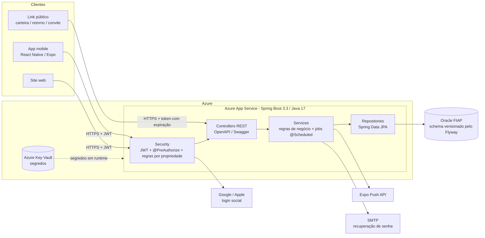
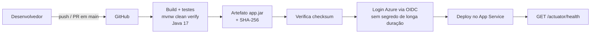
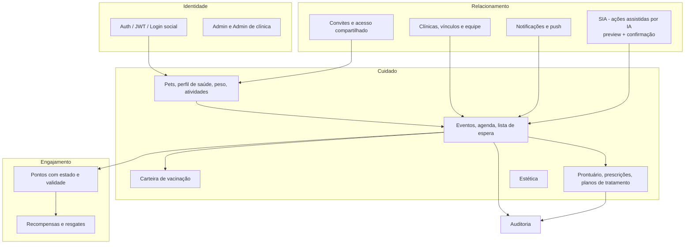

# Arquitetura do VetSync (JornadaPet)

Diagramas em Mermaid (renderizados automaticamente pelo GitHub).

## 1. Visão geral

## 2. Pipeline de CI/CD

## 3. Domínios da aplicação

> Os diagramas descrevem a estrutura lógica. O modelo físico completo está em
> [`scripts/Database/script_bd.sql`](../scripts/Database/script_bd.sql) e nas migrations em
> [`src/main/resources/db/migration`](../src/main/resources/db/migration).
## 4. Organização dos serviços de evento (SOLID)

O ciclo de vida de um evento de saúde foi dividido por responsabilidade (SRP), em vez de concentrado em uma única classe:

| Classe | Responsabilidade única |
|--------|------------------------|
| `EventoService` | Agendar (veterinário, estética e serviço da clínica), buscar e excluir |
| `EventoCancelamentoService` | Cancelar e reagendar; avisa a lista de espera quando um horário é liberado |
| `EventoConclusaoService` | Concluir o atendimento (observações, custo, pontos de fidelidade) |
| `EventoConfirmacaoService` | Confirmar ou recusar o agendamento pela clínica e avisar o tutor |
| `EventoAnexoService` | Anexos (imagens e PDFs) do evento |
| `EventoConsultaService` | Listagens, histórico, gasto total e alertas de atraso |
| `EventoRegistroService` | Histórico e auditoria das mudanças |
| `HorarioAgendaValidator` | Horário existente, não bloqueado e sem conflito |
| `PlanoEventoSincronizador` | Reflete conclusão/cancelamento do evento no plano de tratamento |
| `PoliticaConfirmacaoAgenda` | Regra: agendamento nasce PENDENTE ou já CONFIRMADO |

Utilitários compartilhados que eliminam código repetido (DRY):

- `security/TokenUtils`: geração de tokens, senhas temporárias e códigos aleatórios seguros, e SHA-256 em hexadecimal para guardar tokens apenas como hash.
- `exception/Erros`: fábrica das exceções HTTP repetidas (por exemplo, `Erros.petNaoEncontrado()`), mantendo status e mensagem em um lugar só.
